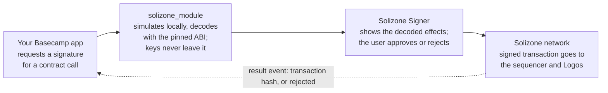
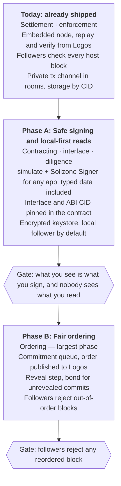

# Solizone PriFi Build Plan

> **Status:** Planned, not started
> **As of:** 2026-11-15
> **Scope:** `solizone-evm`, `solizone_module`, Zoner, SoliCamp
> **Companion to:** [Ecosystem Tools Plan](./ecosystem-tools-plan.md)
>
> Independent project. Not an official Logos project.

---

## Why this plan

Solizone will make three more transaction links checkable instead of trusted. For the user, that means one promise: **safe to sign, private to read, fair to submit.** Most of the building blocks already exist in the code.

Logos's PriFi articles split every transaction into seven links: discovery, diligence, negotiation, contracting, ordering, settlement and enforcement. Blockchains already make settlement credible by structure rather than by promise. The other six links still run on hosted websites, RPC providers and operators that people simply have to trust.

Solizone's job is to close those gaps for Solidity apps, local-first, inside Basecamp. The features live in `solizone_module`, Solizone's Basecamp core module, so **any Basecamp app connected to a Solizone contract can use them**.

SoliCamp stays what it is: the playground where developers write, test and deploy Solidity, and the first app to try each feature. The developer tooling around these features (templates, public testnet, API docs, sample app, explorer) is in the [Ecosystem Tools Plan](./ecosystem-tools-plan.md).

### Already shipped

This plan builds on working code, not a rewrite.

- `solizone_module` is already a Basecamp core module with a generated interface. Any app can call it today through `logos.callModuleAsync("solizone_module", ...)`: `deploy`, `send`, `read`, `encode`, `decode`, `rpc`.
- Module events (for example `chain_started`) that other modules can listen to.
- An embedded node that runs inside the module (`solizone-evm/src/embedded.rs`), with a follower mode.
- Replay and verification of every block from Logos (`replay.rs`, `sync.rs`, `--sync-from-logos`, `zoner sync`).
- Followers that re-execute every host block and check the host's signature (`collab.rs`).
- A private transaction channel over Logos Messaging (`collab.rs`, `net.rs`), used today by SoliCamp rooms.
- Logos Storage upload and download by CID (`logos_storage_client.rs`), plus ABI encode and decode.

### The whole plan as an analogy

Logos built a vault with unbreakable locks. Solizone makes sure the paperwork you sign is the real paperwork, and that nobody watches what you look up (**Phase A**). Then it hands everyone a numbered ticket so nobody can jump the queue (**Phase B**).

---

## What the end user sees

| | Traditional Solidity dApp | Solizone app |
| --- | --- | --- |
| Opening the app | A URL; the page loads from someone's server on every visit | An installed app in Basecamp; no URL, no server |
| Signing | A wallet pop-up with hex data. The website decides what you see | **Solizone Signer**, a screen the app can't draw: "You send 10 X, get at least 9.8 Y, Contract Z can spend 100 X", with a ✓ when the app interface matches the contract |
| Checking balances and state | Every lookup goes to a hosted RPC that sees your IP and what you checked | Answers come from your own node: "Reading from your node" |
| Submitting a transaction | "Pending" in a public mempool, where bots can front-run you | Committed (position #12) → Revealed → Executed in order |

The contracts stay plain Solidity, and the user still clicks Approve or Reject. The trade-offs are a two-step submit, a small bond shown in the Signer, and installing Basecamp instead of opening a link.

---

## How any Basecamp app uses it

A Basecamp app never signs or decodes anything itself. It asks `solizone_module`, and Solizone's own signer screen asks the user.

It works like a card terminal in a shop. Any shop can plug one in, but you read the amount and type your PIN on the terminal's own screen; the shop's till never sees your PIN.

App developers call new methods on `solizone_module`, the same way SoliCamp calls it today. Solidity developers add two view functions (`interfaceCid()`, `abiCid()`) or start from a Zoner template; nothing else changes for them.

| Method or event | What an app gets | Phase |
| --- | --- | --- |
| `simulate(tx)` | Decoded effects of a call before anything is signed | A |
| `request_signature(tx or typed data)` | A request the user approves in Solizone Signer; the app never touches the key. Covers transactions and EIP-712 typed data (permits, approvals, signed terms) | A |
| `signature_resolved` event | The transaction hash or signature, or "rejected" | A |
| `contract_info(address)` | The contract's pinned interface and ABI CIDs | A |
| `follow_network(channel)` | A local follower of the public Solizone chain, used for every read | A |
| `commit_transaction(tx)` | Commit-then-reveal submission, handled by the module | B |

The names are proposals. They join the existing `SolizoneModule` trait, which already generates the interface other modules call.

---

## Roadmap at a glance

Each gate is the "Done when" check of the phase above it. Phase A comes first because ordering also ends in a signature.

---

## Phase A: Safe signing and local-first reads

Phase A guarantees that what a user sees on screen is exactly what they sign, and that nobody learns what they look up. It covers the contracting, interface and diligence links.

### What we build

1. **`simulate` (small).** `try_execute_call` in `revm_engine.rs` already runs revm's `transact`, which computes every state change; today only the receipt is kept. Return the state changes and logs, and expose them as a `solizone_simulate` RPC and a `simulate` module method.
2. **Solizone Signer screen (medium).** A small screen that ships with Solizone itself, not with any app. It shows the decoded effects from `simulate`. Example: "you send 10 X, you receive at least 9.8 Y, contract Z may spend 100 X."
3. **`request_signature` for any app (medium).** A new module method plus `signature_requested` and `signature_resolved` events, built on the module's existing event emitters. Apps can request; only Solizone Signer approves. SoliCamp moves to this path too, as the first app.
4. **Typed-data signing (small).** `request_signature` also accepts EIP-712 typed data, signed with `alloy-signer` (already a dependency). The Signer turns permits and approvals into plain language, for example "lets Contract Z spend up to 100 X until 1 Jan 2027", because signed approvals are a common way users get drained.
5. **Encrypted keystore in `solizone_module` (small).** SoliCamp and Zoner use public dev keys today. A password-protected keystore through alloy gives every app one wallet the user controls.
6. **Interface and ABI pinned in the contract (small, no node changes).** A new `zoner publish-ui` command uploads an app's UI and ABI with `LogosStorageClient`. It records both CIDs in the contract (`interfaceCid()`, `abiCid()`, behind a time-delayed setter), and `contract_info` reads them back for any app.
7. **Local-first reads (small to medium).** `follow_network` makes `EmbeddedNode`'s existing follower mode the default data source for every app that calls `solizone_module`. Balances, contract state and history come from the user's own node, never a hosted RPC.
8. **SoliCamp room encryption fix (small, playground only).** In `collab.rs`, guest transactions are sealed with the shared room key, so every guest can read every other guest's pending transaction. Seal each one to the host's key instead.

**Related:** the `escrow` Zoner template in the [Ecosystem Tools Plan](./ecosystem-tools-plan.md) settles only when both parties' typed-data signatures match the agreed terms. Apps that need private negotiation can pair it with Logos Chat.

### What it brings to the table

- A readable, simulated summary before every transaction and signed message, produced on the user's own machine.
- A dApp interface that can't be swapped silently: changing it takes a public on-chain transaction and a waiting period.
- One root of trust (the contract address) instead of four (server, domain registrar, certificate authority, dependency tree).
- Reads that leave no trace with any provider.
- Pending transactions in SoliCamp rooms that only the host can read.

### Why it's impactful

The $1.5 billion Bybit theft happened at this exact link: the contracts worked perfectly, but the signing interface was compromised. Logos's own article on signing leaves two problems open: "is this the right CID?" and "unreadable data at signing". Phase A answers both for Solidity apps. Logos's coordination article also names hosted RPC lookups as a leak during diligence; local-first reads remove it.

### Real-world analogy

Signing today is like signing a house deed on a form the seller emailed you, while a stranger reads over your shoulder. Phase A is signing at a notary's office with the door closed. The notary reads the deed aloud in plain language from the copy filed at the land registry, and any change to that registered form is posted on the public notice board a week before it takes effect.

### Done when

- [ ] The sample Basecamp app from the Ecosystem Tools Plan, not SoliCamp, gets a signature only through `request_signature` and Solizone Signer.
- [ ] Solizone Signer shows decoded effects from a local simulation before every transaction, and a plain-language summary for every typed-data signature.
- [ ] Changing a contract's interface CID needs an on-chain transaction and waits out its delay.
- [ ] Apps calling `solizone_module` read public-chain state from the local follower by default.
- [ ] A SoliCamp room guest cannot open another guest's pending transaction.

---

## Phase B: Fair ordering

Phase B makes the sequencer fix the order of transactions before it can see what they contain, and lets every follower check that order. It covers the ordering link and is the largest phase, so it comes last.

### What we build

1. **Commitment queue (medium).** Apps call `commit_transaction` on `solizone_module`, which sends only a hash of the encrypted transaction. It sits beside today's first-in, first-out `mempool.rs`.
2. **Order published to Logos (small).** The sequencer publishes the ordered list of commitments as its own inscription on the Solizone channel. The existing `mixed_channel_traffic_is_tolerated` test shows extra non-block inscriptions don't break current followers.
3. **Reveal step (medium).** After the order is published, users reveal their transactions, and the block executes them in exactly the committed order.
4. **New replay rule (medium).** Followers reject any block whose order differs from the committed list. The rule switches on at a set block height in `replay.rs`, so older blocks replay unchanged.
5. **Bond for unrevealed commitments (small).** A small deposit, lost if a user commits but never reveals, stops people from clogging the queue.

### What it brings to the table

- A sequencer that chooses the order without knowing the contents, so it can't front-run or censor based on what a transaction does.
- Reordering that every follower can detect and reject, instead of a promise to behave.
- A public record on Logos of the order the sequencer committed to.

### Why it's impactful

The PriFi article warns that a private order-flow service only moves trust to a new intermediary. Today, Solizone's sequencer is that intermediary. Phase B turns "trust the sequencer to be fair" into a structural rule, which the article calls imperative credibility, for the ordering link. Its value to users grows with traffic, since front-running needs activity to exploit; it is also the clearest proof to Logos that the sequencer can't cheat by design.

### Real-world analogy

Today's ordering is like a shop counter where the clerk sees what everyone wants and decides who gets served first. Phase B is a deli ticket machine. You take a numbered ticket before the counter learns your order, and the ticket log is posted on the wall, so anyone can see if someone was skipped.

### Done when

- [ ] Followers reject a block whose transaction order differs from the committed order.
- [ ] A test shows the sequencer cannot reorder a revealed transaction based on its contents.
- [ ] Unrevealed commitments forfeit their bond.

---

## Out of scope and honest limits

This plan doesn't cover every PriFi link, and saying so plainly matches the tone of Logos's own articles, which separate what is built from what is planned.

- **Private negotiation is left to Logos Chat.** Logos's Chat module already provides encrypted, spam-resistant negotiation. Solizone adds only the binding: typed-data signing in the Signer, plus the `escrow` template in the Ecosystem Tools Plan.
- **Force-inclusion through Bedrock is not possible today.** Only the sequencer key accredited on the channel can publish; `publication/reader.rs` notes that an unaccredited key "can never publish". It needs a change on the Logos side.
- **Settlement stays readable.** Amounts and addresses in executed transactions remain public on Solizone and Bedrock. Shielded settlement is a future layer, not part of this plan.
- **Some pieces depend on Logos's timeline.** Mix inside Delivery, hidden services, publisher anonymity and package signing chains come from Logos. Solizone inherits them when they ship, so describe them as "builds on", not "provides".
- **The contract address is still the root of trust.** If a user is tricked into the wrong contract, its interface CID is "right" for the wrong thing. Phase A reduces four trust points to one, not to zero.
- **Simulation can differ from execution.** State may change before a transaction lands, so the signer should require minimum-output or slippage limits on swaps.

Three more limits come from opening Solizone to every Basecamp app:

- **Caller names are self-declared.** A calling module announces its own name (`set_module_origin`), so Solizone Signer shows it as a hint, never as proof. The decoded effects are what the user should trust.
- **Basecamp screen behaviour needs checking.** It's not yet confirmed whether a module can bring its own screen forward when another module asks. The fallback is a pending-approvals list in Solizone's own tab, like a wallet's request queue.
- **Checking the installed app's CID needs a Basecamp API.** Solizone has no way yet to ask which CID a module was installed from. Until then it verifies the ABI CID, which is fully in its control, and shows the app CID pinned in the contract.