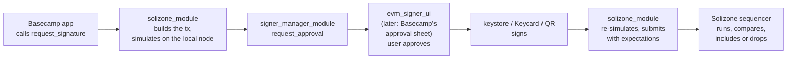

# Solizone Safe Signing Build Plan

> **Status:** Planned, not started
> **As of:** 2026-11-19
> **Scope:** `solizone-evm`, `solizone_module`, Zoner, SoliCamp
> **Refines:** Phase A of the [PriFi Build Plan](./prifi-build-plan.md), items 1–6
> **Companion to:** [Ecosystem Tools Plan](./ecosystem-tools-plan.md), [Storage and Scaling Plan](./storage-scaling-plan.md)
>
> Independent project. Not an official Logos project.

---

## Why this plan

The biggest recent thefts (Bybit, Radiant, WazirX) and most wallet-drainer losses share one cause: **the signer saw one thing and signed another.** Safe signing closes that gap with one rule:

> **Simulate the exact bytes being signed, on the user's own node, and show the result on a screen the app can't draw.**

The research behind this plan changed three things from the PriFi plan:

1. **Logos already has an EVM signing system.** `signer_manager_module` takes requests from any module, and only `evm_signer_ui` may approve them. It already handles keystore, Keycard and QR signers, and checks every signature. Solizone plugs into it instead of building its own Signer and keystore.
2. **That system has no simulation, and nobody enforces a preview.** These are Solizone's real contribution: a local `simulate`, previews that expire, and a sequencer check that drops a transaction whose result no longer matches what the user approved.
3. **The ABI is already pinned by the compiler.** Solidity appends the IPFS hash of the contract's metadata (which contains the ABI) to the runtime bytecode. A separate `abiCid` is unnecessary. The interface pin moves into the contract's `contractURI()` JSON.

---

## What changed from PriFi Phase A

| PriFi Phase A item | Now |
| --- | --- |
| 1. `simulate` | Kept, expanded: signed raw bytes, pending state, next-block context, state diff, token transfers and approvals, block height (**S1**) |
| 2. Solizone Signer screen | Dropped. Approval goes through `signer_manager_module` and `evm_signer_ui` (**S3**). A shell-drawn approval sheet is proposed in a logos-basecamp issue |
| 3. `request_signature` | Kept as the module method apps call, but it forwards to `signer_manager_module.request_approval` (**S3**) |
| 4. Typed-data signing | Handled by the signer manager's `typed_data` legs. Solizone adds plain-language text through ERC-7730 descriptors (**S7**) |
| 5. Encrypted keystore | Dropped. `keystore_module` holds keys through the signer manager. Zoner keeps dev keys for local chains only |
| 6. `interfaceCid()` and `abiCid()` | ABI comes from the bytecode metadata hash (**S6**). Interface pin moves to `contractURI()` (**S8**) |
| New | Fresh previews (**S2**), sequencer check (**S5**) |

---

## How a signature flows



The app only ever gets back a signed transaction hash or a refusal. It never sees a password, a key or a yes/no flag it could forge.

---

## Workstreams

Sizes follow the PriFi plan: small (days), medium (1–2 weeks), large (more).

### S1. Local `simulate` (medium)

**Why:** Every check in this plan starts from "what will this transaction actually change?", answered on the user's own node, so nothing goes to a third-party simulator.

**What exists:** `try_execute_call` in `execution/revm_engine.rs` already runs REVM's `transact` (not `transact_commit`) on the latest or pending state. `eth_call` and `eth_estimateGas` in `node/core.rs` use it. But `ExecutionReceipt::from_revm` keeps only status, gas, output and logs, and drops the state diff. `call_transaction` builds unsigned calls only (`signed: None`).

**Build:**

1. Add `SimulationResult` next to `ExecutionReceipt`: status, gas used, revert reason, logs, the **state diff** from `ResultAndState.state`, and the block height and context used.
2. Accept a **signed raw transaction**: decode it into `SolizoneTransaction` with `signed: Some(..)` and recover the sender, so the bytes simulated are the bytes that will be submitted.
3. Run it on the **pending state** with the **next block's context** (`block_context(timestamp)` in `block_producer.rs`), not the latest block's.
4. Derive what the user cares about:
    - native balance change per address, from the state diff
    - ERC-20 `Transfer` and `Approval` logs, decoded (amount, from, to, spender)
    - ERC-721/1155 transfers and `ApprovalForAll`
    - code changes (a new contract, or a proxy's implementation slot changing)
5. Expose it as:
    - RPC `solizone_simulate(raw_tx | call, "pending")` in `rpc/api.rs`
    - module method `simulate` in `solizone_module`
6. Unit tests: a transfer, an ERC-20 swap, an unlimited approval, a proxy upgrade (Bybit's pattern), and a revert.

**Done when:**

- [ ] `solizone_simulate` returns balance changes, token transfers, approvals and code changes for a signed raw transaction.
- [ ] Simulating and then submitting the same bytes produces the same state diff when nothing else changed in between.
- [ ] A proxy upgrade shows up as "implementation changed", not as a plain call.

### S2. Fresh previews (small)

**Why:** The Scam Sniffer case: a victim signed about 30 seconds after an attacker changed contract state, so the preview was stale. Solizone's default block time is 2 seconds (`block_time` in `embedded.rs`), so 30 seconds is about 15 blocks.

**Build:**

1. Every `SimulationResult` carries the block height it ran at.
2. While a request is waiting for approval, `solizone_module` re-simulates on each new head and updates the lines it sends.
3. A config value `preview_max_age_blocks` (start at 3 and tune): if the latest preview is older, the request is refused rather than signed.
4. After approval, `solizone_module` re-simulates once more right before submitting. If the result differs from what was approved, it does not submit and tells the app why.

**Done when:**

- [ ] A test that changes contract state between approval and submit makes `solizone_module` refuse to submit.
- [ ] A preview older than `preview_max_age_blocks` can't be approved.

### S3. Route signing through `signer_manager_module` (medium)

**Why:** Keys, passwords, hardware wallets and the approval screen already exist in Logos. Reusing them means Solizone gets Keycard and QR signers for free, and a Radiant-style infected computer can be answered with a hardware wallet.

**Build:**

1. Add `signer_manager_module` to `solizone_module`'s dependencies in its `metadata.json`.
2. `request_signature(app, call)` in `solizone_module`:
    1. builds the unsigned transaction (nonce, gas, fees from the local node);
    2. runs **S1** and keeps the result;
    3. calls `signer_manager_module.request_approval` with an intent `{ address, purpose, legs: [{ tx: { chain_id, tx } }] }`;
    4. polls `approval_status`, collects with `fetch_result` and `ack_result`, or cancels with `cancel_approval`;
    5. runs **S2**'s final re-check, then submits (**S5**).
3. Emit the existing-style module events `signature_requested` and `signature_resolved`, so apps can show progress without polling.
4. Respect the manager's limits: 64 KiB per request, four pending per requester.
5. Move SoliCamp to this path first, then the sample app from the Ecosystem Tools Plan.

**Dependency:** the manager writes the lines the user sees, and shows a requester's `purpose` apart from them as an unverified claim. Showing Solizone's simulation as trusted lines needs an optional per-chain simulator the manager calls itself (`simulate(chain_id, tx, from)`), with the simulated block height inside its commitment. Until that exists, Solizone's simulation goes in `purpose`, clearly labelled as coming from `solizone_module`.

**Done when:**

- [ ] SoliCamp signs only through `signer_manager_module`; no Solizone code holds a private key outside local dev mode.
- [ ] A Keycard or QR signer can sign a Solizone transaction.
- [ ] Rejecting in `evm_signer_ui` returns a refusal to the app and submits nothing.

### S4. Typed data and permits (small)

**Why:** Permit and Permit2 signatures caused about 38% of 2025's large drainer losses. A permit moves nothing when signed, so simulation alone shows "no changes".

**Build:**

1. `request_signature` accepts EIP-712 typed data and forwards it as a `typed_data` leg.
2. For known permit shapes (EIP-2612, Permit2), add explicit lines: spender, amount ("unlimited" when max), expiry ("never" when far future), and whether the spender is a new address with no history on the local node.
3. Flag unlimited or non-expiring permits as high risk.

**Done when:**

- [ ] An unlimited, non-expiring USDC-style permit is shown as "lets 0x… spend all your USDC, never expires".

### S5. Sequencer check: enforce the preview (medium)

**Why:** Re-checking (**S2**) shrinks the gap between preview and inclusion but can't close it. Solizone runs its own sequencer, so it can refuse to include a transaction whose result breaks what the user approved. This is the user-level version of what Linea does with Phylax's Credible Layer.

**What exists:** `execute_block_checked` in `revm_engine.rs` already runs each candidate and moves failures into a `rejected` list with an `ExecutionError`.

**Build:**

1. Define `Expectations`, using EIP-7906's terms so a later move to that standard is a format change:
    - net native balance change per address, with a tolerance
    - token `Transfer` and `Approval` events allowed (token, from, to or spender, max amount)
    - no code changes unless declared
    - sender nonce +1 only
2. Add a submit path that carries expectations alongside the raw transaction: `send_with_expectations(raw_tx, expectations)` on the module, and the matching sequencer intake. Plain `eth_sendRawTransaction` keeps working unchanged.
3. In `execute_block_checked`, for a transaction with expectations:
    1. run it with `transact` (no commit);
    2. compare the state diff and logs to the expectations;
    3. commit on a match; otherwise push it to `rejected` with a new `ExecutionError::ExpectationFailed { reason }`.
4. Return the rejection reason to the submitting module, so the app can tell the user "the result changed after you approved; nothing was sent."
5. Tests: a front-run that changes the swap output beyond tolerance, a contract state switch after approval (Scam Sniffer's pattern), and an honest transaction that passes.

**Limit:** expectations are not stored in the block, so followers can't verify the sequencer enforced them. Users trust the sequencer for this check until EIP-7906 (Draft) or an equivalent lands.

**Done when:**

- [ ] A transaction whose result no longer matches its expectations is never included.
- [ ] Transactions sent without expectations behave exactly as today.

### S6. ABI from the bytecode metadata hash (small to medium)

**Why:** A wrong ABI means a wrong decode, and a wrong decode means a misleading screen. Solidity already commits to the ABI inside the contract's code.

**Build:**

1. `contract_abi(address)` in `solizone_module`:
    1. read the runtime code from the local node;
    2. if it's an EIP-1967 proxy, read the implementation slot (`0x360894a13ba1a3210667c828492db98dca3e2076cc3735a920a3ca505d382bbc`) and use the implementation's code;
    3. decode the CBOR block at the end of the code (its length is the last two bytes) and read the `ipfs` hash;
    4. fetch `metadata.json` from Logos Storage (mirror) or IPFS;
    5. re-hash it the IPFS way (UnixFS, CIDv0) and compare to the hash from the code;
    6. return `output.abi`, and cache it by code hash.
2. Zoner:
    - compile with `bytecodeHash: "ipfs"` by default (the compiler's default; make sure templates don't turn it off);
    - at deploy, upload `metadata.json` to Logos Storage and record the mapping.
3. Contracts without a metadata hash (turned off, Vyper, others) show "ABI not verified" and fall back to selector-only decoding.

**Done when:**

- [ ] Every contract deployed with a Zoner template returns a verified ABI from `contract_abi`.
- [ ] A tampered `metadata.json` is rejected.

### S7. Plain-language text: ERC-7730 descriptors (medium)

**Why:** An ABI gives function and field names; users need sentences. ERC-7730 is the standard for that, stewarded since May 2026 by the Ethereum Foundation's Trillion Dollar Security Initiative, with Rust and TypeScript libraries at clearsigning.org.

**Build:**

1. Write an ERC-7730 descriptor for each Zoner template (token, multisig, escrow), with Solizone's chain ID in its context.
2. Store descriptors on Logos Storage; their CIDs go in `contractURI()` (**S8**).
3. In `solizone_module`, render calldata with the descriptor (use the clearsigning.org Rust library if it fits, otherwise a minimal formatter for the fields the templates use).
4. Compare intent and outcome: if the descriptor says "swap 100 USDC" but **S1** shows 10,000 USDC leaving, or a new unlimited approval, flag a mismatch and refuse by default.
5. Later: accept ERC-8176 attestations and show "reviewed by N auditors".

**Done when:**

- [ ] Every Zoner template call is shown as a sentence, not hex.
- [ ] A descriptor/simulation mismatch blocks approval.

### S8. Interface pin in `contractURI()` (medium)

**Why:** Content addressing stops a swapped interface (Bybit's first failure). In Basecamp, apps are installed `.lgx` packages whose content hashes are checked against a Merkle tree and, when signed, carry an Ed25519 signature by the publisher's DID. What's missing is the link from a contract to its official app.

**Build:**

1. Contract side (Zoner templates), following ERC-7572:
    - `contractURI()` returns a Logos Storage URI to a JSON file;
    - a time-delayed setter (kept from the PriFi plan) changes it and emits `ContractURIUpdated`.
2. JSON fields (Solizone extension of the ERC-7572 schema):

    ```json
    {
      "name": "Escrow",
      "interfaces": [
        { "package": "escrow_ui", "rootHash": "<lgx root hash>",
          "publisherDid": "did:jwk:...", "storageCid": "<Logos Storage CID of the .lgx>" }
      ],
      "clearSigning": { "erc7730": "<descriptor CID>" }
    }
    ```

3. `zoner publish-ui` (replaces the PriFi version): read the package's root hash with `lgx manifest`, upload the `.lgx` to Logos Storage, write the JSON, and call the setter.
4. `contract_info(address)` in `solizone_module` returns the parsed JSON.
5. At signing time, compare the requesting module (as Basecamp attests it) against `interfaces`: show "App matches the interface the contract pinned", or a warning when it doesn't or the contract pins nothing.

**Limits:** a pin proves origin, not honesty; a drainer can pin its own app. Pair it with ERC-8176 attestations (**S7**) and Basecamp's Trusted Publishers keys.

**Done when:**

- [ ] `contract_info` returns the pinned packages for every Zoner template.
- [ ] Changing the pin needs an on-chain transaction and waits out its delay.
- [ ] A request from an app whose installed package doesn't match the pin shows a warning.

### S9. Trusted screen (no Solizone code)

**Now:** `evm_signer_ui` shows the manager's lines. It is an ordinary app in an app panel, so another app could draw a look-alike. A fake can't sign, because keys stay with the manager.

**Later:** a shell-drawn approval sheet in Basecamp's overlay, proposed in an issue on the logos-basecamp repo. Solizone's only job is to keep its lines in the manager's plain-data format, so they render in either place.

---

## Order of work

1. **S1** simulate. Everything else depends on it.
2. **S3** route through the signer manager, with simulation in `purpose` for now.
3. **S2** fresh previews.
4. **S6** ABI from the metadata hash.
5. **S4** typed data and permits.
6. **S7** ERC-7730 descriptors for the templates.
7. **S5** sequencer check.
8. **S8** interface pin in `contractURI()`.

---

## Done when (whole plan)

- [ ] SoliCamp and the sample app get signatures only through `request_signature`, `signer_manager_module` and `evm_signer_ui`.
- [ ] Every transaction is simulated on the local node from its signed bytes, and the preview can't be approved when stale.
- [ ] Every Zoner template call shows a plain-language sentence, verified ABI, and pinned-interface check.
- [ ] A Bybit-style proxy upgrade disguised as a transfer is shown as an implementation change and flagged.
- [ ] A transaction whose result changed after approval is never included by the Solizone sequencer.
- [ ] A Keycard or QR wallet can sign any Solizone request.

---

## Open questions

- [ ] Will `signer_manager_module` take an optional per-chain simulator, with the simulated block in its commitment? Decides whether **S3**'s fallback is temporary.
- [ ] Does `keystore_module` sign EIP-155 transactions for any chain ID, including Solizone's? Check before **S3**.
- [ ] How does a module look up another module's installed package root hash in Basecamp? Needed for **S8**'s check.
- [ ] Should expectations (**S5**) be published in the block so followers can verify them, or is sequencer trust acceptable until EIP-7906?
- [ ] When one contract has several honest front ends, who may add to `interfaces`?
- [ ] How should EIP-7702 delegation signatures be shown? (Solizone's transaction model has no authorization list today, so not urgent.)
- [ ] Do Ledger and Trezor clear-sign for any chain ID, so Solizone's ERC-7730 descriptors work on them?

---

## Out of scope

- Building a Solizone-specific signer screen or keystore.
- Changing the EVM transaction format. Expectations travel beside the transaction, not inside it.
- Protecting a user whose computer is infected without a hardware wallet. A software screen can't fully survive that.
- Simulating other chains. The simulator interface is per chain, so others can add their own.